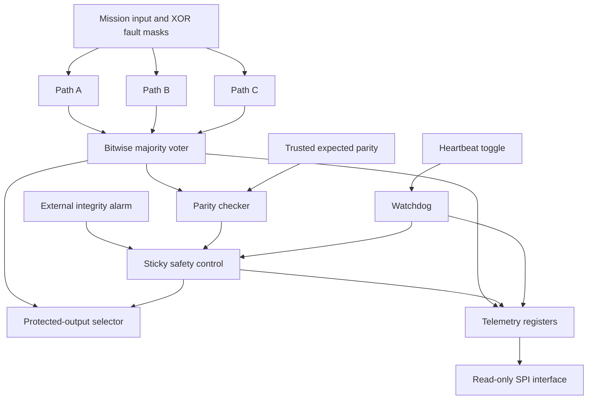

# Corei3 — Fault-Tolerant TMR and Watchdog Controller

**SPEC’26 Space Tech | Combined C model, Verilog simulation, and SPI telemetry dashboard**

Corei3 demonstrates how a computing system can continue producing a correct output when one redundant path fails, detect missing processor progress, enter a safe state, and expose diagnostic information through a read-only SPI interface.

The local dashboard connects to a compiled C model and real clocked RTL simulations. It lets you inject bit flips, stop heartbeat signals, assert an external integrity alarm, advance simulated time, read telemetry registers, and export evidence.

> **Implementation scope:** This is a functional software/RTL simulation. It does not claim physical radiation tolerance, autonomous processor restart, corrupted-memory repair, or FPGA qualification. Safe output `0` is an example inactive command chosen for this demonstration.

## Team Corei3

**NED University of Engineering & Technology, Karachi — Students**

- **RUMAISA WASEEM**
- **MAHNOOR NAEEM**
- **YASHFEEN RAZA**

## Submission files

- [Technical architecture PDF](Corei3_Architecture.pdf)
- [Presentation](demo-presentation/Corei3-Presentation.pptx)
- [Working demonstration video](demo-presentation/Demo.mp4)
- [Hardware architecture reference](ARCHITECTURE.md)
- [Demo and acceptance checklist](JUDGE_DEMO.md)

## Contents

1. [Project overview](#project-overview)
2. [Features](#features)
3. [System architecture](#system-architecture)
4. [Project files](#project-files)
5. [Requirements and setup](#requirements-and-setup)
6. [Dashboard controls](#dashboard-controls)
7. [TMR and fault injection](#tmr-and-fault-injection)
8. [Watchdog and recovery](#watchdog-and-recovery)
9. [Integrity checking](#integrity-checking)
10. [SPI interface and hardware reference](#spi-interface-and-hardware-reference)
11. [Backend API](#backend-api)
12. [Verification and evidence](#verification-and-evidence)
13. [Troubleshooting](#troubleshooting)
14. [Limitations and future work](#limitations-and-future-work)
15. [Presentation checklist](#presentation-checklist)

## Project overview

A space computing system may experience corrupted computation results or loss of processor progress. Corei3 demonstrates complementary protection layers:

| Level | Implementation | Purpose |
|---|---|---|
| Level 1 | Compiled C model | Inject XOR bit faults and evaluate bitwise majority voting against a known expected value |
| Level 2 | Verilog voter, watchdog, and supervisor | Mask path faults and force a safe output after a missing-heartbeat timeout or external integrity alarm |
| Level 3 | Verilog telemetry supervisor and SPI reader | Add trusted-reference parity checking, fault history, episode counters, and serial register access |

The three paths carry the same direct input in this demonstration: `f(x) = x`. They represent redundant computation outputs. The demo does not instantiate three complete processors or run flight software.

## Features

- Eight-bit mission input, from decimal `0` through `255`.
- Independent XOR fault masks for paths A, B, and C.
- Manual per-bit toggles and predefined fault scenarios.
- Bitwise majority voting with visible disagreement and ambiguity indicators.
- Raw voted output displayed separately from protected output.
- Heartbeat synchronization and a sticky watchdog timeout.
- Independent-reference parity check in Level 3.
- External integrity-alarm injection.
- Eleven read-only, 32-bit telemetry registers.
- Actual simulated SPI pin transactions, rather than frontend-generated register values.
- C/HDL path and voter cross-checks after every action.
- Deterministic command replay that preserves simulated timing and latched state.
- Guided mission demonstration, automated verification, and JSON evidence export.
- Local execution with no third-party npm dependencies.

## System architecture



The parity branch belongs to Level 3. Level 2 provides the voter, watchdog, external integrity input, and safe-output selection without the additional voted-parity check.

### Dashboard execution

1. The browser sends a validated action to the Node.js server.
2. The server appends the action to that session’s command list.
3. Icarus Verilog replays the complete list from reset to reconstruct RTL state.
4. The server runs the compiled C model for the resulting input and fault masks.
5. It compares the C path values and raw voted value with the HDL result.
6. The frontend displays the returned state and records the action for export.

A C/HDL match confirms agreement between these implementations. The software oracle separately checks whether the vote matches the known intended value. Agreement between implementations alone does not prove the value is correct.

### Simulated time

Time advances when actions execute. Waiting without interacting does not run a background timer. Actions such as setting faults, toggling heartbeat, resetting, and reading SPI can consume watchdog cycles.

SPI reads take simulated time too. The register response is a snapshot taken during the read, while the returned post-action state reflects the later completed transaction.

## Project files

| Path | Purpose |
|---|---|
| `server.js` | Local HTTP server, compilation, session replay, C/HDL comparisons, and verification API |
| `package.json` | Start, development, and integration-test commands |
| `start.bat` | Windows launcher |
| `tmr.c` | Level 1 C model, command-line interface, and regression tests |
| `public/index.html` | Combined dashboard interface |
| `public/style.css` | Dashboard styles |
| `public/app.js` | Controls, guided demo, session log, counters, and evidence export |
| `rtl/tmr_voter.v` | Bitwise majority voter and disagreement output |
| `rtl/watchdog.v` | Heartbeat synchronizer, elapsed timer, and sticky safety flags |
| `rtl/supervisor.v` | Voter, watchdog, and protected-output selector |
| `rtl/telemetry_supervisor.v` | Level 3 parity check, register decoder, counters, and history |
| `rtl/spi_register_reader.v` | Oversampled SPI Mode 0 register reader |
| `sim/tb_dashboard.v` | Deterministic action replay and dashboard SPI transactions |
| `sim/tb_supervisor.v` | Level 2 regression |
| `sim/tb_level3.v` | Level 3 SPI and integrity regression |
| `test-integration.js` | HTTP-to-C/HDL integration regression |
| `ARCHITECTURE.md` | Detailed hardware architecture and integration assumptions |
| `JUDGE_DEMO.md` | Guided demonstration and acceptance checklist |
| `evidence/integration.txt` | Recorded backend integration and suite results |
| `evidence/browser-checks.txt` | Recorded browser acceptance checks |
| `evidence/browser-session.json` | Example exported session |
| `build/` | Generated executable, simulator images, and simulation output |

`build/` is created automatically. Keep the source directories together when copying the project.

## Requirements and setup

### Required tools

| Tool | Use | Check command |
|---|---|---|
| Node.js with modern built-in `fetch` support | Server and integration tests | `node --version` |
| GCC with C11 support | Compile `tmr.c` | `gcc --version` |
| Icarus Verilog | Compile Verilog/SystemVerilog testbenches | `iverilog -V` |
| Icarus VVP runtime | Execute compiled simulations | `vvp -V` |
| Modern desktop browser | Dashboard | Chrome, Edge, or equivalent |

Node.js 18 or newer provides the built-in APIs used by the integration script. No npm dependency installation is required. All processing runs locally once the toolchain is installed.

### Windows quick start

1. Extract the complete project into a new folder.
2. Stop any old dashboard terminal with **Ctrl+C**.
3. Double-click `start.bat`, or open a terminal in the project root and run:

```powershell
node server.js
```

4. Wait for `Corei3 ready`.
5. Open **http://127.0.0.1:8080**.
6. Keep the terminal open while using the dashboard.

The launcher and server recognize Icarus installed at `D:\iverilog\bin`. For another installation, add its real `bin` directory to your PATH. For example, if that directory exists:

```powershell
$env:Path += ";D:\iverilog\bin"
node server.js
```

### Linux or macOS

After installing the required toolchain and placing it on PATH, run from the project root:

```bash
node server.js
```

The equivalent npm commands are:

```bash
npm start
# or
npm run dev
```

Open the dashboard through the server URL. Opening `public/index.html` directly does not connect the application correctly.

### Startup behavior

The server creates `build/`, compiles the C model with strict compiler flags, and compiles the dashboard, Level 2, and Level 3 testbenches. Startup stops if compilation fails. It does not replace failed simulations with browser-only results.

### Configuration

| Environment variable | Default | Purpose |
|---|---|---|
| `PORT` | `8080` | HTTP listening port |
| `COREI3_HOST` | `127.0.0.1` | HTTP bind address |
| `COREI3_GCC` | `gcc` | GCC executable path |
| `COREI3_IVERILOG` | `iverilog` | Icarus compiler path |
| `COREI3_VVP` | `vvp` | Simulator runtime path |
| `COREI3_IVL_BASE` | Unset | Optional Icarus backend directory passed using `-B` |

Example using another port:

```powershell
$env:PORT = "8081"
node server.js
```

Then open `http://127.0.0.1:8081`. The printed startup banner and integration test currently assume port 8080, so use the default port when running `test-integration.js`.

The server binds to loopback by default. It is a local demonstration server without a production authentication system.

## Dashboard controls

| Control | Behavior |
|---|---|
| Mission input | Selects an eight-bit direct input |
| Path bit buttons | Toggle individual XOR mask bits |
| Fault presets | Replace all three path masks with a predefined scenario |
| Clear faults | Removes injected data faults while preserving safety latches |
| Stop heartbeat | Stops the simulated processor progress signal |
| Resume heartbeat | Restarts progress toggles without clearing safety latches |
| Advance ticks | Runs additional watchdog cycles |
| Inject integrity alarm | Asserts the external integrity input |
| Controlled reset | Clears RTL safety state, hardware counters and history; restores healthy paths and heartbeat |
| New session | Starts fresh session evidence and returns to healthy input 10 |
| Read via SPI | Reads one register through simulated serial transactions |
| Read all | Performs eleven separate SPI transactions |
| Run all verification suites | Executes independent C, Level 2, and Level 3 regressions |
| Export evidence | Downloads session actions, results, register snapshots, and verification output as JSON |

Controlled reset preserves the session’s action log and software correction totals. New session clears session evidence. Reloading also starts a new session, so export important results first.

The visible log shows the latest 100 actions. Export retains the full recorded session. The server limits each session to 500 commands including its initial reset, supports up to 24 stored sessions, and removes idle sessions older than two hours when a new session is created. Restarting the server clears server-side sessions.

## TMR and fault injection

**TMR** means **Triple Modular Redundancy**. The voter compares each corresponding bit across A, B, and C:

```text
voted = (A & B) | (A & C) | (B & C)
```

At every bit position, at least two copies determine the output bit. Different pairs of paths can provide the majority at different positions.

Fault masks use XOR:

```text
A = input XOR mask_A
B = input XOR mask_B
C = input XOR mask_C
```

A mask bit of `1` flips its input bit. A mask bit of `0` preserves it. Presets replace masks instead of accumulating them.

### Single faulty path

For input 10, flip bit 0 in A:

| Value | Binary | Decimal |
|---|---|---:|
| A | `00001011` | 11 |
| B | `00001010` | 10 |
| C | `00001010` | 10 |
| Vote | `00001010` | 10 |

B and C supply the correct majority. The output remains correct even though A is still faulty. Multiple wrong bits confined to one path can also be masked when the other two paths stay correct.

### Different faults across two paths

| Value | Binary | Decimal |
|---|---|---:|
| A | `00000010` | 2 |
| B | `00001011` | 11 |
| C | `00001010` | 10 |
| Vote | `00001010` | 10 |

At bit 3, B and C agree on `1`. At bit 0, A and C agree on `0`. All three complete words differ, yet the bitwise vote remains correct.

`no_word_majority` means all complete path words differ. It is an uncertainty indicator and does not itself trigger safe mode.

### Wrong majority

If A and B both equal `00001011` while C remains `00001010`, the vote becomes 11. Two paths with the same wrong bit outvote the healthy copy.

The TMR voter does not know the intended answer. The dashboard’s software oracle knows it for testing and can label a wrong majority. Hardware disagreement alone cannot establish which copy is correct.

### Supplied presets for input 10

| Preset | Masks A/B/C | Paths A/B/C | Raw vote |
|---|---|---|---:|
| Healthy | `0 / 0 / 0` | `10 / 10 / 10` | 10 |
| Single bit A | `1 / 0 / 0` | `11 / 10 / 10` | 10 |
| Single bit B | `0 / 1 / 0` | `10 / 11 / 10` | 10 |
| Single bit C | `0 / 0 / 1` | `10 / 10 / 11` | 10 |
| 4 bits A | `15 / 0 / 0` | `5 / 10 / 10` | 10 |
| Split faults | `1 / 2 / 0` | `11 / 8 / 10` | 10 |
| Wrong majority | `1 / 1 / 0` | `11 / 11 / 10` | 11 |
| Silent TMR fault | `1 / 1 / 1` | `11 / 11 / 11` | 11 |
| Parity blind spot | `3 / 3 / 0` | `9 / 9 / 10` | 9 |

These are raw votes. Protected outputs also depend on current safety latches.

### Correction counts

The dashboard uses the expected answer as a **test oracle**:

- A software corrected event is a `set` action with disagreement and a correct vote.
- Corrected bit instances sum erroneous path-bit instances masked during those actions.
- A repeated qualifying `set` action can count again even without a new hardware fault episode.
- Advancing time and SPI reads do not inflate those correction totals.
- The counters measure observed masking in test transactions, not physical repairs.

Hardware counters instead count rising disagreement, parity-error, and ambiguity episodes. The two types of counters have different meanings.

## Watchdog and recovery

### Heartbeat

The heartbeat is a toggle signal representing completed processor progress. The dashboard testbench generates a change every five watchdog ticks while enabled. In deployed hardware, software or logic should toggle it only after meaningful work completes.

The watchdog synchronizes the heartbeat with two flip-flops and compares the synchronized value against its previous value. A steady high signal does not count as continuing progress.

### Elapsed counter

At each rising watchdog clock edge, before timeout is latched:

- A detected heartbeat change resets `elapsed` to `0`.
- Without a new change, `elapsed` increments.
- When the configured limit is reached, the timer saturates and sets `timeout_latched`.

For the dashboard, the limit is **64 cycles**. A display of `6 / 64` means six elapsed watchdog cycles against a 64-cycle timeout, rather than six heartbeats.

The standalone `watchdog` and `supervisor` module defaults are 16 cycles. The dashboard explicitly instantiates both supervisors with 64 cycles, and `telemetry_supervisor` defaults to 64. Changing the dashboard timeout requires changing the testbench parameter, not an environment variable.

### Safe-output selection

```text
safe_mode = timeout_latched OR integrity_latched
protected_output = safe_mode ? SAFE_VALUE : voted
```

The demo uses `SAFE_VALUE = 0`. The raw vote stays visible independently of the protected output.

### Watchdog demonstration

1. Set input to 10 and click **Controlled reset**.
2. Click **Stop heartbeat**.
3. Advance 64 ticks and inspect elapsed. Advance further if needed until elapsed reaches 64.
4. Confirm both Level 2 and Level 3 enter safe mode with protected output 0.
5. Read STATUS at `0x04`. A clean timeout-only state returns `0x00000003`.
6. Click **Resume heartbeat**. Both supervisors remain safe.
7. Click **Controlled reset**. Healthy output 10 returns.

A heartbeat already passing through synchronization can reset elapsed shortly after stopping, so do not treat the first stop action as an exact unsynchronized timer boundary.

### Recovery behavior

| Action | Restores path inputs | Restarts heartbeat | Clears safety latches | Clears RTL counters/history |
|---|---|---|---|---|
| Clear faults | Yes | No | No | No |
| Resume heartbeat | No | Yes | No | No |
| Controlled reset | Yes | Yes | Yes | Yes |
| New session | Yes | Yes | Yes | Yes |

Controlled reset asserts active-low `reset_n`. The HDL clears its internal state. Separately, the testbench restores valid A/B/C values, trusted parity, heartbeat generation, external alarm state, and idle SPI signals. Reset release is followed by more simulated cycles, so elapsed need not display zero.

Resetting the supervisor does not repair a real processor, reload trustworthy software, or scrub corrupted memory. Such recovery mechanisms need separate system design.

## Integrity checking

### External integrity alarm

**Inject integrity alarm** simulates an external checker reporting a fault. It asserts `integrity_fault`, which sets the integrity latch in both supervisors. The implementation does not scan or intentionally corrupt memory when this button is pressed.

Removing the alarm does not clear the latch. Controlled reset is required.

### Level 3 parity check

```text
parity_fault = XOR(voted) != expected_parity
```

`expected_parity` must be independently trustworthy. In the testbench, it comes from the known valid input. Generating it from the potentially corrupted voted output would defeat the check.

For input 10, `00001010` has two set bits and XOR parity 0. A wrong vote of 11, `00001011`, has three set bits and parity 1. Level 3 detects the difference and latches safe mode. With heartbeat still running, Level 2 alone continues passing the wrong raw value.

For input 10 with A=B=9 and C=10, the wrong vote `00001001` also has parity 0. The parity check misses this even-bit error. The software oracle can still label it **UNDETECTED ERROR** because it knows the expected answer.

Parity detects odd numbers of wrong output bits relative to a correct reference. It does not identify or correct the faulty bits and cannot guarantee detection when the reference is also corrupted.

## SPI interface and hardware reference

**SPI** means **Serial Peripheral Interface**. It lets another device inside a system read supervisor telemetry. Satellite radio equipment would be needed to forward that information to Earth; SPI itself is not a space-to-ground link.

Only SPI is implemented here. No AXI interface is implemented.

### Top-level pins: `telemetry_supervisor`

| Name | Direction | Width | Definition |
|---|---|---:|---|
| wd_clk | input | 1 | Free-running clock independent of protected processor |
| reset_n | input | 1 | Active-low reset; clears counters and sticky safety |
| heartbeat_toggle_async | input | 1 | Toggle after useful completed processor work |
| integrity_fault | input | 1 | External corruption alarm, synchronous to wd_clk |
| a, b, c | input | 8 each | Coherent redundant computation-path values |
| expected_parity | input | 1 | Trusted independent XOR parity of valid output |
| spi_cs_n | input | 1 | Active-low SPI chip select |
| spi_sck | input | 1 | Mode 0 serial clock, idle low |
| spi_mosi | input | 1 | Master sends address MSB first |
| spi_miso | output | 1 | Serial response; high impedance when CS inactive |
| voted | output | 8 | Raw majority result |
| protected_output | output | 8 | Raw majority or zero in safe mode |
| disagreement | output | 1 | Not all path words equal |
| safe_mode | output | 1 | Latched timeout or integrity alarm |
| parity_fault | output | 1 | Raw voted parity differs from expected_parity |
| no_word_majority | output | 1 | All three complete words differ |

The Level 3 top-level TIMEOUT_CYCLES parameter defaults to 64; use an integer from 1 through 2^31-1.
Reset assertion is asynchronous. In physical integration, release reset through
a wd_clk-domain reset synchronizer/controller. The board must supply an actual
independent watchdog clock. The model proves behavior with heartbeat absent,
not physical clock independence or radiation tolerance.

### Fault interpretation

Disagreement is an observable fact, not proof the voted answer is correct.
The no_word_majority flag is an uncertainty indicator: bitwise voting can still
be correct when all three whole words differ. It does not automatically assert safe mode.

The independent parity reference provides a concrete check for wrong-majority
odd-bit corruption, including two paths flipping the same bit. expected_parity
must come from a trustworthy independently protected source, not be calculated
from voted. In the testbench it comes from the known healthy input. No general
reference-generation or memory-integrity engine is claimed in the RTL.
If the reference is corrupted too, detection can fail. Even numbers of wrong
output bits can preserve parity. Neither TMR nor this parity check guarantees
detection of every multi-path fault. CRC/ECC or application plausibility checks
could improve coverage but are outside this implementation.

integrity_fault is for an external monitor; the implementation does not scan
memory. Either external alarm or parity fault sets integrity_latched.
A watchdog cannot detect wrong data when valid progress continues.

### SPI protocol

Read-only custom register protocol, standard Mode 0 electrical timing:
CPOL=0, CPHA=0, MSB first. Assert CS low with SCK low; transmit one 8-bit byte
address. Then transmit 32 dummy zero bits while reading the 32-bit response.
Deassert CS after the response. There is one address/response per CS frame.
No command prefix, burst transfer, auto-increment, or write is supported.
Unmapped/misaligned byte addresses return 0xDEADBEEF.

The response snapshots one complete 32-bit register at the final address bit.
Changes during the response do not tear that register. Multiple separate reads
are not a global atomic snapshot. Historical flags preserve transient events.
Aborted frames are discarded when CS deassertion is observed.

SPI inputs are oversampled/synchronized in wd_clk, not used as generated clocks.
Require SCK high and low periods of at least 8 wd_clk periods; hold CS low at
least 8 periods before the first rising SCK, and high at least 8 periods between
frames. MOSI must be stable at least 4 wd_clk periods before each rising edge
and held through that edge. This limits SCK to wd_clk/16 or slower. MISO becomes
valid after synchronization delay following a falling edge; sample it at the
next rising edge. The testbench uses a slower compliant clock.
MISO tri-state is intended for a top-level FPGA output buffer; implement the
appropriate I/O primitive or separate data/enable signals on a target device.

### Register map (all read only)

| Byte address | Register | Value/definition |
|---|---|---|
| 0x00 | ID | 0x43334933 |
| 0x04 | STATUS | Current flags, see below |
| 0x08 | MISMATCH_EVENTS | Rising disagreement episodes |
| 0x0C | PARITY_EVENTS | Rising voted-parity-error episodes |
| 0x10 | AMBIGUOUS_EVENTS | Rising no-word-majority episodes |
| 0x14 | PATH_SNAPSHOT | [31:24] C, [23:16] B, [15:8] A, [7:0] voted |
| 0x18 | PROTECTED_OUTPUT | Protected value in bits [7:0] |
| 0x1C | ELAPSED | Watchdog ticks, saturating at timeout |
| 0x20 | HISTORY | Sticky historical flags, see below |
| 0x24 | TIMEOUT | Configured TIMEOUT_CYCLES |
| 0x28 | VERSION | 0x00010000 (interface v1.0) |

STATUS: bit 0 safe_mode; bit 1 timeout_latched; bit 2 integrity_latched;
bit 3 disagreement; bit 4 no_word_majority; bit 5 parity_fault;
bit 6 external integrity_fault; bit 7 and bits [31:8] reserved zero.

HISTORY: bit 0 timeout observed; bit 1 integrity latch observed;
bit 2 disagreement observed; bit 3 no-word-majority observed;
bit 4 parity fault observed; bit 5 external integrity alarm observed;
remaining bits zero. Latch-derived history can lag current status by one wd_clk
tick. Current status remains available immediately after the core updates.

Event counters count rising episodes, not elapsed faulty cycles or confirmed
corrections. They saturate at 0xFFFFFFFF. A fault that stays asserted counts
once; deassertion followed by assertion counts again. All clear on reset_n.
There is no ground-truth corrected-error counter in hardware.

### Integration assumptions and verification

Path words and parity must be coherent and stable around wd_clk sampling.
They are not individually synchronized multi-bit clock-domain buses. A real
processor integration must supply a stable sampled interface/handshake.
Heartbeat uses a two-flop synchronizer and must toggle slowly enough to be
observed. Timeout margin must exceed heartbeat period, CDC delay and tolerance.
No heartbeat resumes can clear the sticky safe state; only controlled reset.

The Level 2 regression tests 6,932 checks. The Level 3 suite tests 31 assertions,
including actual bit-serial reads of ID, status, counters, output, snapshots,
history, version, invalid addresses, timeout while SPI remains responsive,
parity detection, its even-bit blind spot, CS abort recovery and atomic response.
This is functional RTL simulation; synthesis, FPGA timing closure, board tests,
and radiation qualification have not been performed.


## Backend API

The frontend uses a small JSON API. Requests mutate simulated session state, not physical hardware.

| Method | Endpoint | Purpose |
|---|---|---|
| GET | `/api/health` | Server readiness and most recent verification result |
| POST | `/api/session` | Create a new isolated simulation session |
| POST | `/api/action` | Apply one validated session action |
| POST | `/api/verify` | Run all three standalone verification suites |

### Session creation

Request:

```json
{}
```

Send it to `POST /api/session`. The response contains `session` and `state`. Use the returned session identifier unchanged in action requests.

### Action fields

All actions need `session` and `action`:

| Action | Additional fields | Accepted values |
|---|---|---|
| `reset` | `input` | Integer 0–255 |
| `set` | `input`, `masks` | Input 0–255 and exactly three integer masks 0–255 |
| `advance` | `ticks` | Integer 1–1024 |
| `heartbeat` | `enabled` | Boolean |
| `integrity` | `enabled` | Boolean |
| `spi` | `address` | Integer 0–255 |

Example single-path injection, after substituting a returned session ID:

```json
{
  "session": "RETURNED_SESSION_ID",
  "action": "set",
  "input": 10,
  "masks": [1, 0, 0]
}
```

Example STATUS read:

```json
{
  "session": "RETURNED_SESSION_ID",
  "action": "spi",
  "address": 4
}
```

Returned state includes paths, raw vote, Level 2 and Level 3 outputs, safety flags, elapsed cycles, hardware event counters, history, the most recent SPI address/value, C-model results, and a cross-check indicator.

Malformed or invalid actions return HTTP 400. Unknown sessions return 404. The action limit returns 409, and the stored-session limit returns 429. Simulation or tool failures return an error rather than a nominal result. The server rejects mutation requests with an explicit nonmatching browser Origin header. This is a local safeguard, not a complete authentication or deployment security system.

## Verification and evidence

### Recorded results

The supplied evidence files record the following results. These are the recorded project results, not a claim that documentation generation reran the suites.

| Suite | Recorded checks | Recorded failures | Evidence |
|---|---:|---:|---|
| C Level 1 | 7,180 | 0 | `evidence/integration.txt` |
| Level 2 HDL | 6,932 | 0 | `evidence/integration.txt` |
| Level 3 SPI HDL | 31 | 0 | `evidence/integration.txt` |
| Backend integration assertions | 50 | 0 | `evidence/integration.txt` |

The three standalone suites total **14,143 checks**. The integration suite adds 50 HTTP/backend assertions and also invokes the standalone suites. Its output therefore repeats their results rather than representing another independent execution category to double-count.

The C output records **6,144 single-bit fault injections** within its 7,180 checks. The Level 2 suite exercises voter and watchdog behavior. Level 3 includes serial register reads, safety status, invalid addresses, abort recovery, response atomicity, and parity limitations.

### Rerun from the dashboard

Click **Run all verification suites**. These tests run separately from the active mission simulation and do not mutate its session state. Inspect the PASS indicators and output, then export evidence.

### Rerun integration

Stop any dashboard server first so port 8080 is free:

```bash
node test-integration.js
```

Or:

```bash
npm test
```

The integration script starts its own server and stops it when testing completes. It expects port 8080. A successful run ends with:

```text
INTEGRATION PASS: 50 checks, zero failures.
```

### Run the compiled standalone suites

Start the server once to generate build artifacts, then use the following commands from the project root.

Windows PowerShell:

```powershell
.\build\tmr.exe --test
vvp build/tb_supervisor.vvp
vvp build/tb_level3.vvp
```

Linux/macOS:

```bash
./build/tmr --test
vvp build/tb_supervisor.vvp
vvp build/tb_level3.vvp
```

Testbenches can write VCD waveforms in the current working directory. Through the server, their working directory is `build/`.

### C-model example

The JSON command accepts the input followed by three decimal XOR masks:

```bash
./build/tmr --json 10 1 0 0
```

On Windows, use `.\build\tmr.exe` instead. This example produces A=11, B=10, C=10, and voted=10. The C JSON interface is also what the backend uses for its cross-check.

### Exporting a demonstration

1. Start a fresh session.
2. Run the intended fault scenarios.
3. Read relevant SPI registers.
4. Run verification if required.
5. Click **Export evidence** before reloading or closing.

The JSON export records actions, simulator states, C comparisons, SPI snapshots, and available verification output. A screenshot is useful visual evidence, while JSON preserves machine-readable session results.

### Screenshot checklist

Capture actual results, with values readable:

| Evidence | Required visible information |
|---|---|
| Healthy state | A=B=C=10, protected output 10 |
| Single-bit masking | A=11, B=C=10, raw vote 10, FAULT MASKED |
| Wrong majority | A=B=11, C=10, Level 2 output 11, Level 3 safe output 0 |
| Watchdog timeout | Elapsed 64 and both protected outputs 0 |
| SPI during hang | STATUS address `0x04`, response `0x00000003` |
| Recovery | Controlled reset followed by healthy output 10 |
| Verification | All three suite PASS results |

## Troubleshooting

| Symptom | Likely cause and action |
|---|---|
| `node` not recognized | Install Node.js or fix PATH, then reopen the terminal |
| Startup compilation failed | Check GCC, `iverilog`, and `vvp` availability and read the terminal error |
| Icarus compiler works but backend tools cannot be found | Use a consistent Icarus installation; set `COREI3_IVL_BASE` only when that installation requires its backend directory |
| Port 8080 already in use | Stop the previous server with Ctrl+C, or choose another port for manual dashboard use |
| Blank page or API errors after opening HTML | Launch `server.js` and use the HTTP URL rather than a file URL |
| Timer does not change while waiting | Simulation advances through actions, not wall-clock waiting |
| Elapsed starts at a small nonzero value | Reset and synchronization consume simulated cycles |
| Resume heartbeat leaves output 0 | Safety is latched; use Controlled reset |
| Clear faults leaves output 0 | Data faults cleared, but the safety latch remains active |
| Raw vote is 10 but protected output is 0 | A timeout or integrity latch still selects the safe value |
| Every path differs but vote is correct | Voting is per bit; different pairs can supply each majority |
| Wrong vote passes Level 2 | A watchdog checks progress, not numerical correctness |
| Wrong vote also passes Level 3 | An even-bit change can preserve parity; use the blind-spot demo to illustrate this |
| SPI rows show different action times | Each read is a separate snapshot, not a simultaneous live table |
| MISMATCH_EVENTS does not rise every faulty cycle | Counters count rising fault episodes |
| Verification fails to start on its own server | Stop the old dashboard and restore default port 8080 |
| Session expired or action limit reached | Export available evidence, then create a new session |
| Previous evidence disappears after reload | Reload starts a new frontend session; export before reloading |

## Limitations and future work

### Current limits

- Functional C and RTL simulation only.
- No physical radiation testing, FPGA board verification, or synthesis/timing-closure claim.
- No complete processor model or space-to-ground radio implementation.
- No automatic memory scanning, scrubbing, ECC repair, or trusted software reload.
- TMR can produce a wrong majority when multiple paths share faulty bits.
- Complete-word disagreement does not establish output correctness.
- Watchdog monitoring cannot detect every fault while valid heartbeats continue.
- Parity depends on an independently trusted reference and misses even-bit changes.
- The demonstration’s known expected input is a testing oracle, not an omniscient deployed monitor.
- A real integration needs coherent path words, protected reference generation, reset control, and suitable clock-domain crossings.
- A real watchdog needs a physically independent clock source.
- Safe value 0 needs application-specific justification before controlling actuators.
- SPI register writes, burst reads, auto-increment, and AXI are outside the current design.
- The synchronous local backend is suitable for small demonstrations, not a high-throughput production service.

### Possible extensions

- CRC/ECC and application plausibility checks for stronger data-integrity coverage.
- Independently protected reference generation and storage.
- Memory scrubbing and controlled software restart policies.
- FPGA synthesis, clock-domain analysis, and board-level SPI validation.
- Hardware-specific MISO output-buffer integration.
- Application-specific safe-command handling.
- A global snapshot mechanism for correlated multi-register telemetry.
- An AXI interface if required by the target platform.

These are future directions, not implemented features.
